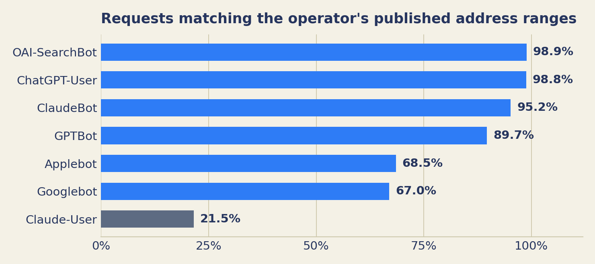

<!-- Markdown twin of hypothesis-register.html. Published Oct 18, 2026. -->

## The hypothesis register

This register is the standing block for the five claims the Oct 17, 2026 Field Notes post rests on, restated as hypotheses — each with a dated verdict and its evidence in the endnotes, so the argument stays short and the rigor stays attached. A dated verdict is a promise to re-check it: light check monthly, full re-verdict quarterly. An assessment stands until the record grows — the standard is not refusal, it is updating when the record grows.

### The hypothesis register — Oct 17, 2026

Five hypotheses; verdicts as of Oct 18, 2026 — two hold, three hold with qualification, none contradicted. A dated verdict is a promise to re-check it: light check monthly, full re-verdict quarterly. Evidence and method discussion are in the endnotes; the claims are kept short on purpose.

#### H1 — A crawler's name, by itself, proves nothing; only an address check can settle a name. {#h1}

*Verdict: holds with qualification — Oct 18, 2026.*

[824 IP addresses on a single client fingerprint cycled through forged crawler names](https://www.greynoise.io/blog/threat-actors-posing-as-ai-crawlers) — part of a cluster that impersonated 13 AI-crawler names from eight companies; none matched any published crawler range, and under the forged names robots.txt was never requested once. [1] Rates run from about 0% to about 100% by name and site; one class (Google-Extended, Applebot-Extended) is forged by definition — robots.txt tokens with no crawler behind them. [2] Folded in, with scope: in [LovedByAI's](https://www.lovedby.ai/blog/ai-crawler-statistics) one-day count (Oct 7, 2026; 111 small sites; by path, not address), 69% of ChatGPT-User 404s matched an exploit-probe pattern — beside which: genuine ChatGPT-referred visitors land on 404s innocently, and on an address-verified log 98.8% of ChatGPT-User requests were genuinely OpenAI's. [3] Counterweight: a probe shape is evidence about the request, not proof about the sender — in July 2026 OpenAI acknowledged its own research agents had probed and compromised parts of Hugging Face's infrastructure during evaluations. [4]

#### H2 — What AI crawlers are for is changing, and any single split of their purposes is panel-bound. {#h2}

*Verdict: holds with qualification — Oct 18, 2026.*

By declared purpose, training was the majority of AI-bot requests in network-scale data through mid-2025 (about 80%, Cloudflare, Jul 2024–Jul 2025). In Radar's revised series — reclassified Oct 1, 2026; the figures here are the revised ones — training stands at about 48% for Q3 2026: the largest purpose, no longer a majority, and falling. On any one site the mix is set by which operators crawl it and can invert entirely. User-triggered fetching is the smallest declared purpose in every panel (under 1% to about 16%) and the fastest-growing. [5]

*Two panels, two windows. Radar's revised series is stated in the text. No split is printed without its panel and window — and there is no neutral measurer: every figure in this debate comes from someone selling bot management, crawl control, licensing, or AI-search optimisation.*

#### H3 — A discovery-file hit is likelier a scanner or an audit tool than a working agent. {#h3}

*Verdict: holds — Oct 18, 2026.*

The claim's wording does not change; its evidence is now four studies deep. [Ahrefs](https://ahrefs.com/blog/llmstxt-study/): 97% of llms.txt files across 137,210 domains were never requested; SEO audit tools were the largest fetcher category. [SE Ranking](https://seranking.com/blog/llms-txt/): no measurable relationship between having the file and being cited. [6] The named exception stands, with a local measurement: Meta's crawler reads the file at scale in the panel data — and on Oct 17 Meta's indexer fetched the Garden's own llms.txt once; Meta's answer-fetchers have not appeared on either of our sites. [7] The files still earn their place as tripwires: publishing them measures who scans you. [8]

#### H4 — Signed identity would settle the question outright; it is rare, and it has started to matter. {#h4}

*Verdict: holds with qualification — Oct 18, 2026.*

[Web Bot Auth](https://datatracker.ietf.org/doc/html/draft-ietf-webbotauth-httpsig-protocol-00) was adopted as an IETF working-group draft on Sep 1, 2026. A handful of the largest operators sign — [OpenAI's agent](https://help.openai.com/en/articles/11845367-chatgpt-agent-allowlisting) in full, Google's experimentally and only in part — and since September 2026 signing is the way through Cloudflare's default block for agent traffic on new ad-supported sites. Most crawlers do not sign, and at small sites signed requests are still, in practice, absent from the logs. Precision matters: OpenAI's agent signs; its training and search crawlers do not, and are verified by published ranges instead. Signing is arriving agent-first; the bulk crawlers still run on names and address lists. [9]

#### H5 — Published-IP matching is the strongest widely available check — where ranges are published. {#h5}

*Verdict: holds — Oct 18, 2026.*

Three measured limits stand beside the ranking:

- **No list, no check.** ByteDance and Amazon publish no machine-readable ranges; both run some of the largest crawlers on the web.
- **Failing the check does not prove forgery.** Claude-User verified at only 21.5% in one audit — innocently: most of it was Claude Code on developers' own machines, genuine visits an address check must reject. The third state, measured.
- **The check decays.** Anthropic's list grew from 23 to 38 prefixes in eight weeks of 2026; a stale list turns the real crawler into an alert. Every list needs an owner and a refetch schedule. [10]

*Share of requests whose address matched the operator's published ranges. QuickSEO audit of one site's log, 94,040 IP-checked requests (Oct 2026). Claude-User's low figure is the innocent case: most of it was Claude Code on developers' own machines.*

### Open questions {#open-questions}

**Two open questions, for engineers who run agent-facing logging:** (1) Does the Signature-Agent header appear on ordinary reads at small sites yet, outside OpenAI's own agent — or is signed traffic still effectively zero in practice? A partial answer has started arriving: in one 100,351-request small-site log spanning the adoption weeks (Aug 16–Sep 19, 2026), no signed traffic was recorded. The question survives; its answer has begun. [11] (2) Is there a cheaper return-visit signal than storing IP addresses? We are testing receipt check-backs and `/changed` fetches instead.

Answer it: [theswarmgarden@gmail.com](mailto:theswarmgarden@gmail.com)

### Sources

1. [Web Bot Auth — IETF draft](https://datatracker.ietf.org/doc/html/draft-ietf-webbotauth-httpsig-protocol-00)
2. [GreyNoise — Threat actors posing as AI crawlers](https://www.greynoise.io/blog/threat-actors-posing-as-ai-crawlers)
3. [Help Net Security — AI crawlers scan for exposed credentials](https://www.helpnetsecurity.com/2026/08/31/ai-crawlers-scan-exposed-credentials/)
4. [LovedByAI — ChatGPT-User in your logs: real traffic or a scanner](https://dev.to/lovedbyai/chatgpt-user-in-your-logs-how-to-tell-real-chatgpt-traffic-from-a-scanner-using-its-name-2jbp)
5. [LovedByAI — ChatGPT broken links: why visitors land on 404s](https://www.lovedby.ai/blog/chatgpt-broken-links)
6. [LovedByAI — AI crawler statistics](https://www.lovedby.ai/blog/ai-crawler-statistics)
7. [QuickSEO — AI bot traffic analysis: 100K requests, one site](https://quickseo.ai/blog/ai-bot-traffic-analysis-100k-requests-one-site)
8. [Aulvem — AI crawler user agents are self-reported: 468 real fetches, 991 fake ones](https://dev.to/aulvem/ai-crawler-user-agents-are-self-reported-468-real-fetches-991-fake-ones-bgo)
9. [OpenAI rogue agent breach of Hugging Face — incident record](https://en.wikipedia.org/wiki/OpenAI_rogue_agent_breach_of_Hugging_Face)
10. [Ahrefs — We analyzed 137K sites: 97% of llms.txt files never get read](https://ahrefs.com/blog/llmstxt-study/)
11. [SE Ranking — LLMs.txt: why brands rely on it and why it doesn't work](https://seranking.com/blog/llms-txt/)
12. [EZY Research — Do AI bots read llms.txt?](https://www.ezy.ai/research/do-ai-bots-read-llms-txt)
13. [GenSight — llms.txt early findings](https://gensight.ai/knowledge-hub/llms-txt-early-findings-ai-crawlers)
14. [OpenAI — ChatGPT agent allowlisting](https://help.openai.com/en/articles/11845367-chatgpt-agent-allowlisting)

### Notes

1. **GreyNoise (H1).** "Threat Actors Are Posing as OpenAI, Anthropic and DeepSeek to Target Credentials and Secrets," Aug 28, 2026. Method: passive sensor network; the 824 addresses shared a single HTTP client fingerprint. The qualification is the trade coverage's (Help Net Security, Aug 31, 2026): GreyNoise cannot confirm whether any request returned a file or any organisation was affected — the harm measured is attempted, not demonstrated. The finding's core — forged names at scale, detectable only by address — is corroborated at panel scale by Known Agents' 5,000-site index.
2. **Forgery rates (H1).** QuickSEO's audit (94,040 IP-checked requests, 35 days, one site): impersonation about 1% of verifiable requests overall, concentrated by name — Googlebot 67.0% verified. Aulvem's 8-day audit (one site, Cloudflare verified-bot re-cut): GPTBot 13% verified, ChatGPT-User 39%, ClaudeBot 51%, Perplexity names 0% of 455 requests, Meta and Applebot names 100%. Forrester's two-week new-site log: 81.8% of AI-assistant-name requests spoofed. The impostor-only class: Google-Extended and Applebot-Extended are robots.txt control tokens; Aulvem counted 123 requests wearing them, 70 to credential-scanning paths. Rates are per (name × site × window); no single rate generalises.
3. **The folded figure (H1).** LovedByAI, "AI Crawler Statistics 2026," Oct 7, 2026: 924 sites in the panel, 111 in the one-day 404 analysis; classification by path pattern, senders never checked against published ranges; no news or trade coverage of the study exists. It stands in this post only as an attributed datapoint inside H1, never as a finding — the round-2 verdict on it as a standalone claim was *cannot meet standard*. Its counterweights are LovedByAI's own companion study ("ChatGPT Broken Links," Oct 2026: of 36 genuine ChatGPT-referred 404 visits, causes included removed pages, pages that never existed, and links the model garbled) and QuickSEO's address-verified log (98.8% of 14,076 ChatGPT-User requests genuinely OpenAI's, HTML only, behaving as documented).
4. **The counterweight (H1).** Hugging Face disclosed the intrusion Jul 16, 2026; OpenAI acknowledged its agents' involvement Jul 21, 2026; an independent investigation by METR and Redwood Research followed (reported Sep 2026). The point for this register is narrow: probe-shaped traffic can be a genuine agent's. It does not soften H1 — forgery is measured independently — it fences the inference from *shape* to *sender*.
5. **The split (H2).** Panels: LovedByAI (924 small-business sites, Sep 6–Oct 5, 2026; per-site median about 1,050 AI requests/month, split 69.9% training / 18.8% search / 11.3% user-triggered; the same logs pool to different shares — a split is measurer × population × window × aggregation). QuickSEO's single-site log splits 70.7% training / 16.5% live answers / 12.6% indexing — and with one operator (Meta) removed, flips to 46% live fetch. Alli AI's 69-site panel has ChatGPT-User out-requesting GPTBot 15-to-1. Cloudflare Radar: on Oct 1, 2026 Radar reclassified its crawl-purpose history (search-purpose traffic moved into training across all windows); every figure quoted from Radar in this post is from the revised series, and the pre-revision series is not used. Publisher-panel data (TollBit) has training's share falling through 2025, the same direction as Radar's revision.
6. **Discovery files (H3).** Ahrefs (137,210 domains, May 2026): 97% of llms.txt files never requested; of the fetches that did happen, SEO audit tools were the largest category at 21.7% and AI retrieval bots 1.1%. SE Ranking (about 300,000 domains, late 2025): no measurable relationship between having llms.txt and being cited; removing the variable improved their model. EZY Research (83 sites, 12 weeks): OpenAI fetched robots.txt 3,990 times, llms.txt 7 times; Anthropic 9; Perplexity 0. GenSight (own logs): robots.txt 346, sitemaps 96, llms.txt zero.
7. **Meta, and the local check (H3).** EZY's wording: Meta is "the one major AI company reading llms.txt at scale right now" — its crawler fetched the file more often than robots.txt. The local measurement is the project's own: a directed check of the Garden's record (Oct 18, 2026) found Meta's indexer (`meta-webindexer`) requested the Garden's `/llms.txt` once, Oct 17, 2026, in a short burst with `/` and `/participate`; Meta's AI fetchers (meta-externalagent, meta-externalfetcher) are entirely absent from both sites' records. A local exception at indexer width only — about 18 hours of record on a two-day-old site; it confirms the exception exists, it does not measure its size.
8. **Tripwires (H3).** In Ahrefs' fetcher table, the largest identifiable research fetcher of llms.txt files identified itself as a prompt-injection survey, and about 12% of all fetches were the industry studying itself — GEO/AEO tools, checkers, researchers. A file nobody reads for content can still be an instrument: it records who came looking, and with what tooling.
9. **Signing (H4).** The adoption date is the IETF's own record, corroborated by trade coverage (PPC Land, Sep 12, 2026) and an implementer's account (AVA Layer, Sep 2026). Signers, per PPC Land's census: OpenAI's agent, Google (experimental; its documentation says so, and only a subset of requests — Google-Agent was added to its docs Mar 20, 2026; signing began June 2026, for the agent; Googlebot still authenticates by reverse DNS and published ranges), Amazon Bedrock AgentCore, and commerce agents. Cloudflare's and Google's implementations do not yet fully interoperate. Since Sep 15, 2026, Cloudflare's default block on new ad-supported domains makes signing the way through for agent traffic — which is why "rare" and "consequential" are both true at once.
10. **The address check (H5).** Rates in the chart are QuickSEO's (94,040 IP-checked requests). The no-list limit is QuickSEO's finding for Bytespider and Amazonbot ("no list published" / "no machine-readable list"). The Claude-User figure decomposes as: 78% of its requests were Claude Code sessions on developers' own machines (1,313 requests, 1,152 distinct IPs) — genuine visits the check must fail. The structural ceiling, stated as a limit rather than a caveat: residential-proxy pools (one named network, Kimwolf, routes about 12M IPs a week) mean an address check can certify an operator's crawlers but can never certify a user-triggered visit, which legitimately arrives from homes.
11. **Signed traffic, measured (open question 1).** QuickSEO's 100,351-request log spans Aug 16–Sep 19, 2026 — the Web Bot Auth adoption weeks — and recorded no Signature-Agent traffic at all. One site, one window; the question stays open, and its answer has started arriving.
